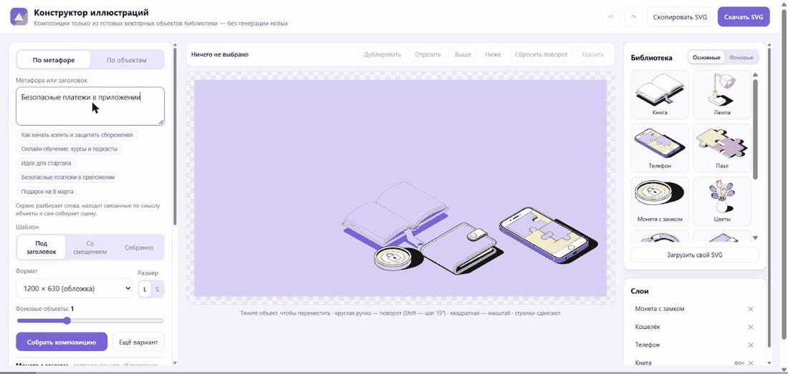

# Конструктор иллюстраций

Веб-сервис, который собирает векторные композиции **только из готовых элементов** библиотеки.
В ней 20 иллюстраций из макета: 10 основных (цветных) объектов и 10 фоновых (монохромных),
каждая в двух размерах — **L** (детальный) и **S** (упрощённый), итого 40 SVG-файлов. Новые объекты
не генерируются, геометрия исходных элементов не меняется — к объекту применяются только
перемещение, поворот, равномерный масштаб и зеркальное отражение.

**Работающий сервис:** https://illustration-composer-petrov.netlify.app



*Демонстрация:* метафора «Безопасные платежи в приложении» → подбор объектов → шаблон «Собранно» →
переключение размеров S/L → палитра «Персик» → перемещение и поворот объекта → копирование SVG.

## Что умеет

| Требование | Как сделано |
|---|---|
| Сценарий 1: метафора / заголовок → композиция | Поле «По метафоре»: текст разбирается на основы слов и сопоставляется со словарём ассоциаций каждого объекта. Показывается, почему выбран каждый объект |
| Сценарий 2: названия компонентов → композиция | Вкладка «По объектам»: «книга, лампа, ручка». Неизвестные слова перечисляются отдельно |
| Работа с SVG и библиотекой | Готовая библиотека (`library/`) + загрузка своих SVG через «Загрузить свой SVG» |
| Сборка композиции | Три шаблона из макета («Под заголовок», «Со смещением», «Собранно»), 4 формата холста, 0–3 фоновых объекта, «Ещё вариант» |
| Выбор размера с подгрузкой своих элементов | Переключатель L/S подменяет каждый объект на холсте его вариантом нужной детализации из макета, сохраняя положение, поворот и правки пользователя |
| Редактирование | Перетаскивание, поворот (ручка, Shift — шаг 15°), масштаб, дублирование, отражение, удаление, порядок слоёв, панель слоёв, отмена/повтор, стрелки |
| Цветовая палитра | 3 палитры из макета, ручная правка цветов, загрузка файла палитры (JSON/CSS/.gpl/список) и автоматическая перекраска. Новые схемы добавляются одной строкой в `palette.js` |
| Правило фонов из макета | Фон всегда берётся из цвета фона схемы; цвет, который используется в объектах, фоном поставить нельзя (сервис предупреждает) |
| Экспорт | «Скачать SVG» / «Скопировать SVG». Каждый объект — отдельная группа с исходными векторными путями, без растра. Проверено: файл импортируется в Figma с правильными поворотами, масштабом и толщиной линий |

## Запуск

Сборка не нужна — это статический сайт на ES-модулях.

```bash
python -m http.server 8790
```

Затем открыть http://localhost:8790. Тесты ядра: `npm test` (Node 18+). Примеры: `npm run examples`.

## Архитектура

```
index.html, styles.css    интерфейс
js/app.js                 состояние, панели, история (undo/redo), localStorage, экспорт
js/ui/editor.js           холст: отрисовка и жесты (move / rotate / scale)
js/core/                  ядро без DOM — работает и в браузере, и в Node
  catalog.js              объекты библиотеки: названия, синонимы, ассоциации, «компаньоны»
  svg.js                  разбор SVG, нормализация цветов, перекраска атрибутов fill/stroke
  palette.js              роли цветов, пресеты, разбор файла палитры, сопоставление цветов
  metaphor.js             сценарии 1 и 2: основы слов, подсчёт совпадений, объяснение
  layout.js               шаблоны раскладки, вписывание в холст, порядок по глубине
  render.js               трансформации объекта и сборка итогового SVG
library/, library/s/      40 SVG-элементов: L и S, основные и *-bg фоновые
examples/                 примеры собранных композиций
tools/                    извлечение библиотеки из макета и генерация примеров
tests/                    тесты ядра (node:test)
```

### Хранение и извлечение SVG-элементов

1. Из Figma листы «Размер L» и «Размер S» скопированы как SVG — получаются плоские списки
   из 1610 и 1526 путей без групп (`source/size_L.svg`, `source/size_S.svg`; не публикуются).
2. `tools/split.html` в браузере считает рамку (`getBBox`) каждого пути и объединяет пути,
   рамки которых касаются друг друга (union-find с зазором 12 px). Подложка листа исключается.
   Получились кластеры-объекты; два случая (книга + лампа, монета + отколовшийся кусочек)
   разведены вручную по индексам.
3. `tools/split-library.mjs` режет исходный SVG по найденным индексам и пишет каждый объект
   в отдельный файл с собственным `viewBox`: `library/*.svg` (L) и `library/s/*.svg` (S).
   Пути копируются байт-в-байт.

В рантайме каждый файл разбирается в `{ viewBox, body, colors }` (`js/core/svg.js`) и хранится
под ключом `объект:вариант:размер` (например, `phone:bg:S`). `body` — исходная разметка путей,
она нигде не перестраивается.

### Размеры L и S

S-рисунки в макете вдвое меньше и проще (у телефона нет пазла на экране, у монеты — замка).
На холсте S-объект занимает ~72 % площади L-двойника. При переключении размера
`convertItemSize` меняет ключ библиотеки и пересчитывает масштаб так, чтобы центр объекта
остался на месте, — ручные правки не теряются, а переключение отменяется одним Ctrl+Z.

### Переиспользование элементов

Объект на холсте — это лёгкая запись `{ id, variant, x, y, scale, rotation, flip }`.
При отрисовке тело объекта оборачивается в две группы:

```svg
<g transform="translate(x y) rotate(r cx cy) scale(s)">     ← меняется при редактировании
  <g transform="[зеркало] translate(-viewBox.x -viewBox.y)"> ← приводит объект к началу координат
    …исходные пути…
```

Внутренняя часть кэшируется по паре «объект + палитра», поэтому один элемент можно поставить
на холст сколько угодно раз, а во время перетаскивания меняется только один атрибут `transform`.

### Перекраска

Библиотека нарисована в палитре «Лаванда», и у каждой палитры из макета 8 цветов в одинаковых
ролях: светлый (фон), средний, тёмный, контур, три акцента, белый. Поэтому перекраска — это
замена цвета по роли (`#F9A3AA` акцент 2 → `#80DADA` в «Персике»), меняются только значения
`fill`/`stroke`. Цвет, которого нет в палитре (например, в загруженном SVG), идёт по ближайшей роли.
Загруженный файл с 8 цветами читается по ролям; с другим количеством цветов — контур и белый
определяются по яркости, остальные распределяются от светлого к тёмному.

### Подбор объектов по метафоре

Слова приводятся к основе (отсечение окончаний, ё→е), стоп-слова отбрасываются. Совпадение
с названием объекта даёт 5 баллов, с ассоциацией — 2 (многословные ассоциации вроде «8 марта»
сравниваются целиком). Берутся до 4 лучших объектов; если совпадений меньше трёх, сцена
дополняется «компаньонами» (книга ↔ лампа ↔ ручка и т. д.). Подход детерминированный, работает
офлайн и объясним; словарь легко расширить, а модуль можно заменить на вызов LLM с тем же интерфейсом.

### Раскладка

Шаблон задаёт область холста и схему: ряд по «полу» (под заголовок), два смещённых ряда
(со смещением), главный объект в центре и остальные вокруг (собранно). Размеры объектов сжимаются
к медиане (монета в 5 раз меньше книги, но не должна теряться), группа вписывается в область,
фоновые объекты уходят назад, основные сортируются по нижней кромке — так соблюдается
изометрическая глубина. Случайность задаётся seed, поэтому «Ещё вариант» воспроизводим.

## Примеры

- `examples/01-metaphor-savings.svg` — «Как начать копить деньги и защитить свои сбережения», «Под заголовок», «Персик»
- `examples/02-metaphor-learning.svg` — «Онлайн-обучение: курсы, вебинары и подкасты», «Собранно», «Мята»
- `examples/03-names-office.svg` — «папка, ручка, лампа, пазл», «Со смещением», «Лаванда», размер S

## AI-инструменты

- **Claude Code (Anthropic)** — разработка: разбор задания, извлечение и нарезка SVG-библиотеки
  из макета, код ядра и интерфейса, тесты, проверка в браузере.

В самом сервисе AI во время работы не используется: подбор объектов по метафоре — словарный
и детерминированный.
